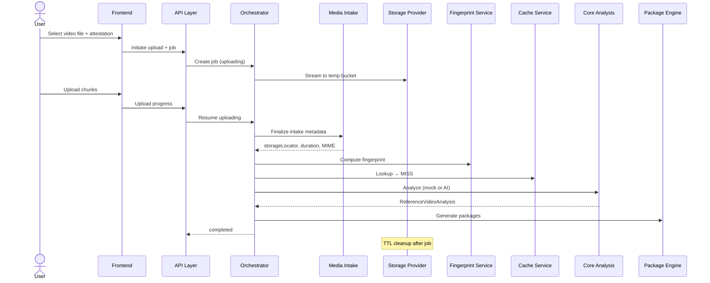
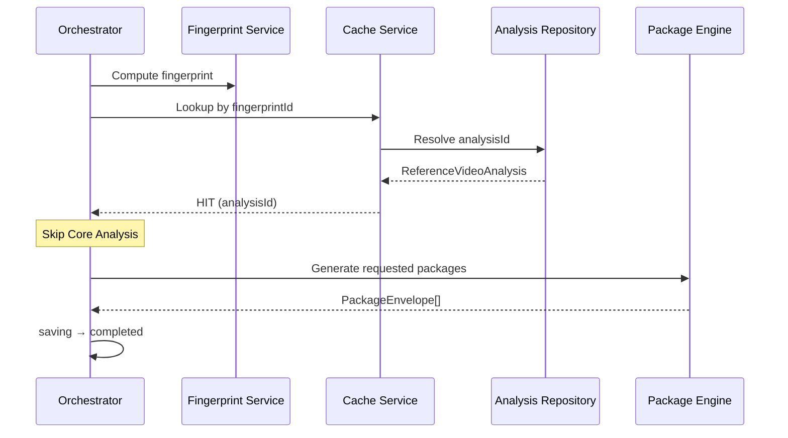
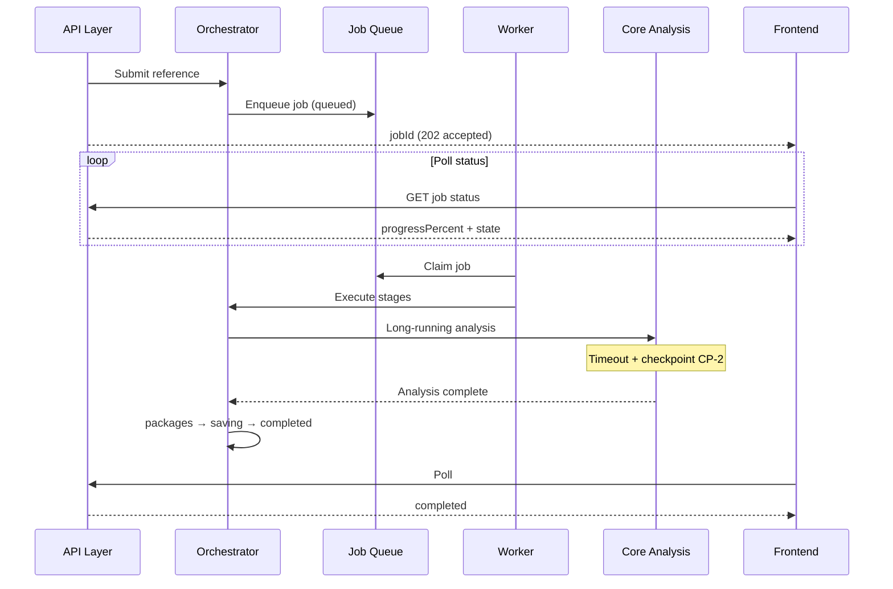
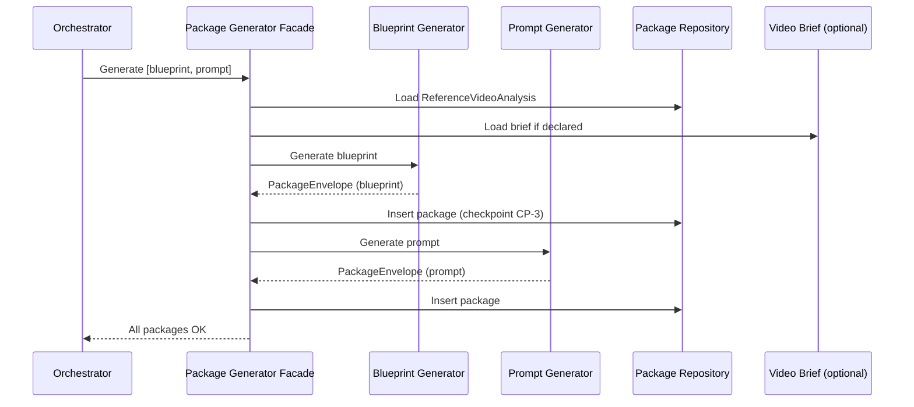
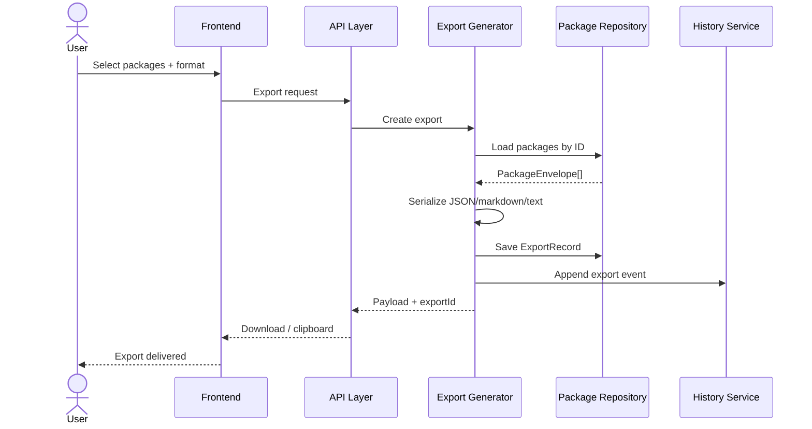

# PP-04G — Runtime Sequence Diagrams

**Related:** [04b-end-to-end-runtime-pipeline.md](04b-end-to-end-runtime-pipeline.md) · [04e-runtime-orchestrator.md](04e-runtime-orchestrator.md)

Conceptual sequence diagrams only. Participants use PP-02/PP-03 terminology.

---

## 1. URL Analysis (YouTube)

```mermaid
sequenceDiagram
    actor User
    participant FE as Frontend
    participant API as API Layer
    participant VAL as Request Validator
    participant ORC as Orchestrator
    participant LINK as Link Intelligence
    participant MEDIA as Media Intake
    participant FP as Fingerprint Service
    participant CACHE as Cache Service
    participant CORE as Core Analysis
    participant PKG as Package Engine
    participant REPO as Repositories

    User->>FE: Submit YouTube URL + attestation
    FE->>API: Create reference job
    API->>VAL: Validate payload
    VAL-->>API: Valid command
    API->>ORC: Start job
    ORC->>REPO: Create Reference + Job (created)
    ORC->>ORC: validated → queued → preparing
    ORC->>LINK: Normalize URL, SSRF-safe check
    LINK-->>ORC: Platform metadata descriptors
    ORC->>MEDIA: Resolve URL reference
    MEDIA-->>ORC: Media descriptors (no download)
    ORC->>ORC: fingerprinting
    ORC->>FP: Compute fingerprint
    FP->>REPO: Save fingerprint
    ORC->>CACHE: Lookup
    CACHE-->>ORC: MISS
    ORC->>ORC: analyzing
    ORC->>CORE: Analyze descriptors
    CORE-->>ORC: ReferenceVideoAnalysis
    ORC->>REPO: Persist analysis
    ORC->>CACHE: Write cache entry
    ORC->>ORC: generating_packages
    ORC->>PKG: Generate blueprint + prompt
    PKG-->>ORC: PackageEnvelope[]
    ORC->>REPO: Persist packages
    ORC->>ORC: saving → completed
    ORC-->>API: Job complete
    API-->>FE: Status + IDs
    FE-->>User: Workspace results
```

---

## 2. Uploaded Video Analysis



---

## 3. Cached Analysis (cache hit)



---

## 4. Long Video Processing (async worker)



---

## 5. Package Generation



---

## 6. Export Generation



---

## Step 04G acceptance

- [x] Six sequence diagrams documented
- [x] Terminology consistent with PP-02/PP-03
- [x] Conceptual only — no implementation
