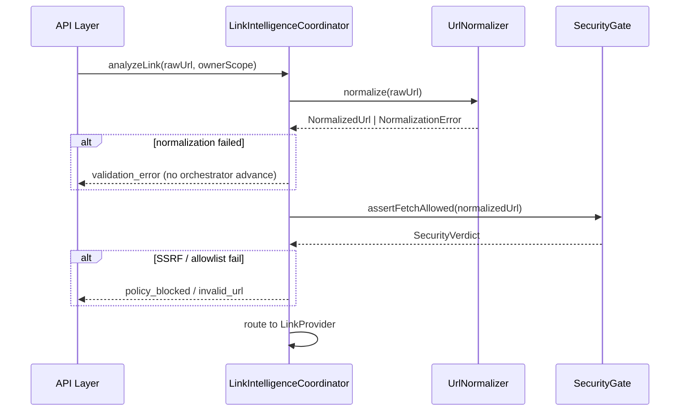
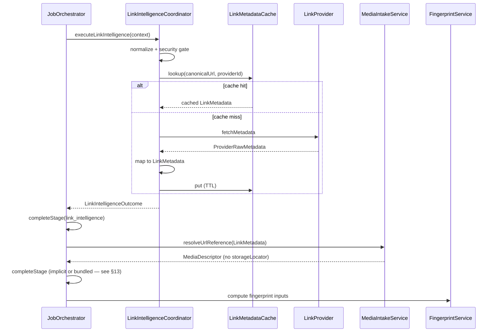
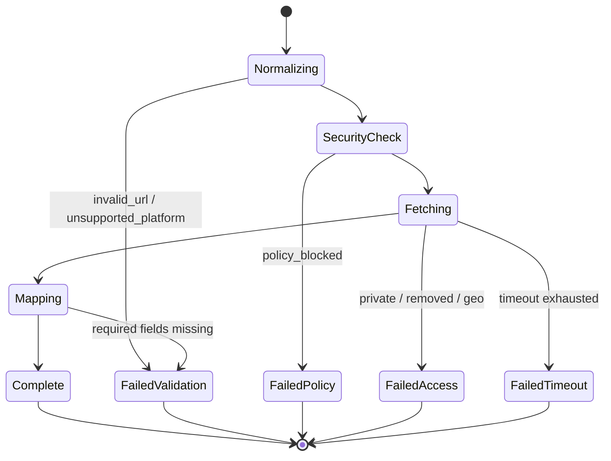
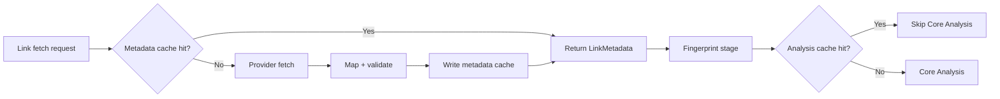
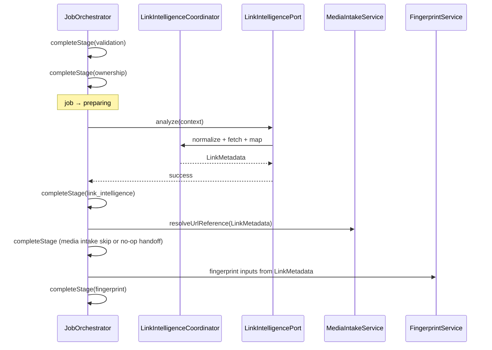

# PP-05 — Link Intelligence Engine Design Audit

**Phase:** Design only  
**Status:** COMPLETE (pending approval)  
**Rule:** No production code, HTTP, provider SDKs, SQL, workers, AI calls, or orchestrator runtime changes.

**Related:** [PP-04C service boundaries](../pp-04/04c-service-boundaries.md) · [PP-04G sequences](../pp-04/04g-runtime-sequence-diagrams.md) · [PP-02 fingerprint](../pp-02/05-content-fingerprint.md) · [PP-08 orchestrator](../pp-08/README.md) · [PP-07 media intake](../pp-07/README.md)

---

## Executive summary

Link Intelligence is the **only authorized outbound URL fetch path** (G-25). It normalizes platform URLs, performs SSRF-safe metadata extraction, and emits **canonical `LinkMetadata`** consumed by Media Intake, Fingerprint, and Core Analysis — without downloading video media or calling AI.

For `youtube_url` references, the engine inserts a dedicated **`link_intelligence` pipeline stage** between `ownership` and `fingerprint` (replacing the PP-08 interim path that skips directly to fingerprinting). Upload references (`video_upload`, `audio_upload`) **never** invoke Link Intelligence.

---

## 1. Link Intelligence architecture

### 1.1 Component model

```text
┌─────────────────────────────────────────────────────────────────┐
│                        API Layer (thin)                          │
│  Auth · project scope · DTO validation · orchestrator delegate   │
└───────────────────────────────┬─────────────────────────────────┘
                                │
                                ▼
┌─────────────────────────────────────────────────────────────────┐
│                     JobOrchestrator (PP-08)                      │
│  Plans stages · delegates link_intelligence · completeStage      │
└───────────────────────────────┬─────────────────────────────────┘
                                │
                                ▼
┌─────────────────────────────────────────────────────────────────┐
│              LinkIntelligenceCoordinator (PP-05)               │
│  URL gate · provider routing · retry · cache consult · map DTO   │
└───────┬─────────────────┬─────────────────┬─────────────────────┘
        │                 │                 │
        ▼                 ▼                 ▼
┌──────────────┐  ┌──────────────┐  ┌──────────────────┐
│ UrlNormalizer│  │ SecurityGate │  │ LinkMetadataCache│
│ (pure)       │  │ (SSRF)       │  │ (PP-09 port)     │
└──────────────┘  └──────────────┘  └──────────────────┘
        │
        ▼
┌─────────────────────────────────────────────────────────────────┐
│              LinkProviderRegistry (provider abstraction)         │
│  YouTubeProvider · VimeoProvider · MockLinkProvider (dev/test)   │
└─────────────────────────────────────────────────────────────────┘
```

### 1.2 Responsibility boundaries

| Component | Owns | Must never |
|-----------|------|------------|
| **LinkIntelligenceCoordinator** | End-to-end link analysis for one reference | Download media; call AI; persist directly |
| **UrlNormalizer** | Parse, canonicalize, detect platform | HTTP fetch |
| **SecurityGate** | SSRF checks, allowlist enforcement | Business metadata mapping |
| **LinkProvider** | Platform metadata fetch (bounded HTTP) | Cross-platform logic; storage writes |
| **LinkMetadataCache** | Short-TTL metadata reuse (PP-09) | Analysis cache; fingerprint computation |
| **JobOrchestrator** | Stage progression, failure propagation | Provider HTTP calls |
| **MediaIntakeService** | Map link output → media descriptors | URL fetch |
| **FingerprintService** | Content identity from descriptors | Platform API calls |

### 1.3 Reference kind matrix

| `referenceKind` | Link Intelligence | `media_intake` stage |
|-----------------|-------------------|----------------------|
| `youtube_url` | **Required** | Skipped |
| `video_upload` | Skipped | Required |
| `audio_upload` | Skipped | Required |
| `transcript` | Skipped | Skipped (text path) |
| `script` | Skipped | Skipped (text path) |

Future URL kinds (`vimeo_url` as distinct kind, or generic `platform_url`) extend `requiresLinkIntelligence()` — design preserves provider registry extensibility without new pipeline topology.

---

## 2. URL normalization flow

### 2.1 Normalization pipeline

```text
Raw user URL string
        │
        ▼
Trim · length cap (2048) · reject non-http(s)
        │
        ▼
Parse with WHATWG URL parser (no manual regex-only parsing)
        │
        ▼
Lowercase host · strip tracking query params · sort remaining params
        │
        ▼
Platform detector (host + path patterns)
        │
        ├── no match ──► unsupported_platform (terminal)
        │
        ▼
Platform-specific canonicalizer
        │
        ▼
NormalizedUrl + PlatformContentId + ReferencePlatform enum
```

### 2.2 YouTube canonicalization rules

| Input pattern | Canonical form | Content ID extraction |
|---------------|----------------|----------------------|
| `youtube.com/watch?v=ID` | `https://www.youtube.com/watch?v=ID` | `v` param |
| `youtu.be/ID` | `https://www.youtube.com/watch?v=ID` | path segment |
| `youtube.com/shorts/ID` | `https://www.youtube.com/watch?v=ID` | shorts path |
| `youtube.com/embed/ID` | `https://www.youtube.com/watch?v=ID` | embed path |
| `youtube.com/live/ID` | `https://www.youtube.com/watch?v=ID` | live path |

**Excluded in MVP:** playlist URLs without single-video resolution, channel-only URLs, `/c/` handles without video ID.

### 2.3 Vimeo canonicalization rules (planned)

| Input pattern | Canonical form | Content ID |
|---------------|----------------|------------|
| `vimeo.com/123456789` | `https://vimeo.com/123456789` | numeric ID |
| `player.vimeo.com/video/123456789` | `https://vimeo.com/123456789` | path ID |

### 2.4 Normalization sequence



### 2.5 Pre-orchestration vs in-stage normalization

| When | Action |
|------|--------|
| **API create-reference** | Structural URL validation only (scheme, length, attestation present) — **no outbound fetch** |
| **`link_intelligence` stage** | Full normalization + security gate + provider fetch |

This preserves G-25: no fetch before the Link Intelligence boundary, and no orphan jobs on malformed URLs when combined with PP-07B-style validation ordering.

---

## 3. Supported provider abstraction

### 3.1 `LinkProvider` port (design)

```typescript
// Design-only — not implemented in this phase

type LinkProviderId = 'youtube' | 'vimeo' | 'mock';

type LinkProviderCapabilities = {
  supportsOEmbed: boolean;
  supportsMetadataApi: boolean;
  maxDurationSeconds: number; // product cap alignment
};

type LinkFetchRequest = {
  normalizedUrl: NormalizedUrl;
  platformContentId: PlatformContentId;
  ownerScope: MediaOwnerScope;
  requestedAt: IsoDateTime;
};

type LinkFetchResult =
  | { ok: true; payload: ProviderRawMetadata }
  | { ok: false; code: LinkProviderErrorCode; retryable: boolean; message?: string };

interface LinkProvider {
  readonly providerId: LinkProviderId;
  readonly capabilities: LinkProviderCapabilities;
  detect(url: URL): boolean;
  extractContentId(url: URL): PlatformContentId | null;
  fetchMetadata(request: LinkFetchRequest): Promise<LinkFetchResult>;
}
```

### 3.2 Provider registry

```typescript
interface LinkProviderRegistry {
  detectProvider(url: URL): LinkProvider | null;
  getProvider(providerId: LinkProviderId): LinkProvider | undefined;
  registerProvider(provider: LinkProvider): void;
}
```

### 3.3 MVP provider scope

| Provider | MVP | Metadata source (implementation phase) |
|----------|-----|--------------------------------------|
| YouTube | **Yes** | oEmbed + optional Data API (server key) |
| Vimeo | **Planned** | oEmbed |
| Mock | Dev/test | Fixture JSON |
| TikTok, Instagram, etc. | **Deferred** | Requires legal + API review |

### 3.4 Provider isolation rules

- Each provider adapter lives behind `LinkProvider` — no YouTube-specific branches in coordinator beyond registry routing.
- Provider adapters may use HTTP client with global timeout and response size cap.
- Raw provider JSON is **never** returned to clients — mapped to `LinkMetadata` only.

---

## 4. Canonical LinkMetadata model

### 4.1 Purpose

`LinkMetadata` is the **stable, provider-neutral output** of Link Intelligence. It feeds:

1. **Reference** record enrichment (`canonicalUrl`, `platformContentId`, `title`, `accessStatus`)
2. **Media Intake** descriptors (duration, media kind hints — no `storageLocator`)
3. **Fingerprint** inputs (`platformContentId`, normalized URL identity)
4. **Core Analysis** observed metadata section (via ReferenceVideoAnalysis metadata fields)

### 4.2 Schema (design)

| Field | Type | Required | Confidence | Notes |
|-------|------|----------|------------|-------|
| `linkMetadataId` | EntityId | Yes | — | Internal record id |
| `referenceId` | EntityId | Yes | — | Owning reference |
| `projectId` | EntityId | Yes | — | Denormalized for ownership asserts |
| `ownerId` | EntityId | Yes | — | Denormalized for ownership asserts |
| `referenceKind` | `youtube_url` (+ future) | Yes | observed | |
| `platform` | `ReferencePlatform` | Yes | observed | `youtube`, future `vimeo` |
| `platformContentId` | string | Yes | observed | Stable platform video id |
| `canonicalUrl` | https URL | Yes | observed | Post-normalization |
| `originalUrl` | https URL | Yes | observed | User submission (audit) |
| `title` | string | No | observed | From provider |
| `authorLabel` | string | No | observed | Channel / creator display name |
| `channelId` | string | No | observed | Platform channel id when available |
| `durationSeconds` | positive int | No | observed | Required before fingerprint if product cap applies |
| `publishedAt` | IsoDateTime | No | observed | |
| `language` | BCP-47 | No | observed / inferred | |
| `thumbnailUrl` | https URL | No | observed | **URL only — not downloaded** |
| `aspectRatio` | string | No | inferred | e.g. `16:9` when derivable |
| `mediaKind` | `video` \| `audio` | No | observed | Default `video` for YouTube |
| `accessStatus` | AccessStatus | Yes | observed | Maps to Reference.accessStatus |
| `embedAllowed` | boolean | No | observed | Product hint for UI |
| `providerId` | LinkProviderId | Yes | — | Which adapter produced record |
| `extractionMethod` | `oembed` \| `api` \| `mock` | Yes | — | Audit trail |
| `extractedAt` | IsoDateTime | Yes | — | |
| `linkMetadataVersion` | semver string | Yes | — | Schema version for cache invalidation |
| `providerPayload` | Record | No | — | **Internal only — never API** (G-29 parallel) |

### 4.3 Mapping to existing contracts

| LinkMetadata field | PP-03 target |
|--------------------|--------------|
| `canonicalUrl`, `platform`, `platformContentId`, `title` | `ReferenceSchema` |
| Metadata subset | `ReferenceVideoAnalysis.metadata` (observed facts) |
| `durationSeconds`, `mediaKind`, `thumbnailUrl` | Media Intake descriptor + analysis metadata |

### 4.4 Identity and immutability

- One **active** `LinkMetadata` record per `(referenceId, linkMetadataVersion)` at persistence time.
- Re-analysis of same reference with unchanged URL may **reuse** cached LinkMetadata if TTL valid.
- URL change on reference creates new extraction — new metadata record.

---

## 5. Metadata extraction pipeline

### 5.1 Stage-local pipeline

```text
link_intelligence stage start
        │
        ▼
Load Reference + raw URL from orchestration context
        │
        ▼
Normalize URL (§2)
        │
        ▼
Security gate (§11)
        │
        ▼
Consult LinkMetadataCache (§10) ── HIT ──► map to LinkMetadata → complete stage
        │ MISS
        ▼
Select LinkProvider via registry
        │
        ▼
fetchMetadata with retry (§8)
        │
        ▼
Map ProviderRawMetadata → LinkMetadata
        │
        ▼
Validate required fields (platformContentId, accessStatus)
        │
        ▼
Write LinkMetadataCache entry
        │
        ▼
Persist LinkMetadata (PP-05C adapter — deferred)
        │
        ▼
Return to orchestrator → completeStage(link_intelligence)
```

### 5.2 Extraction sequence (orchestrated)



### 5.3 Media Intake handoff

Link Intelligence **does not** replace Media Intake. After link stage:

- Media Intake receives `LinkMetadata` and produces **URL media descriptors**:
  - `mediaKind`, `durationSeconds`, `mimeType` hints (`video/mp4` logical, not a stored object)
  - **No** `storageLocator` (G-29)
  - Transcript source hint: `platform_caption` (fetch deferred to Core Analysis / transcription boundary)

---

## 6. Thumbnail strategy

| Rule | Detail |
|------|--------|
| **No download in MVP** | Store HTTPS `thumbnailUrl` only |
| **No storageLocator** | Thumbnail is not a WorkspaceAsset |
| **Client usage** | UI may render `` directly from platform CDN |
| **Proxy deferred** | Optional thumbnail proxy for CSP/privacy — post-MVP |
| **Validation** | `thumbnailUrl` must pass same allowlist host rules OR be on platform CDN allowlist |
| **Fingerprint** | Thumbnail URL **excluded** from fingerprint inputs (volatile CDNs) |
| **Analysis** | Core Analysis may reference thumbnail URL as observed metadata only |

---

## 7. Duration, title, and channel extraction

### 7.1 Field extraction matrix

| Field | YouTube (oEmbed) | YouTube (API) | Vimeo (oEmbed) | Fallback |
|-------|------------------|---------------|----------------|----------|
| `title` | Yes | Yes | Yes | `null` — job continues with warning |
| `durationSeconds` | Sometimes | Yes | Yes | Required for duration cap enforcement — fail if missing and cap enabled |
| `authorLabel` | Yes (`author_name`) | Channel title | User name | Optional |
| `channelId` | No | Yes | Optional API | Optional |
| `thumbnailUrl` | Yes | Yes (pick best) | Yes | Optional |

### 7.2 Duration policy

- Product duration cap (from brief / project policy) enforced **after** extraction, before fingerprint.
- If provider omits duration and cap policy requires it → `validation_error` / `duration_exceeded` investigation path.
- Duration bucket for fingerprint (PP-02) uses extracted `durationSeconds` when present.

### 7.3 Title and channel usage

- `title` populates Reference and seeds ReferenceVideoAnalysis metadata as **observed** confidence.
- `authorLabel` maps to analysis `metadata.authorLabel` (see fixture pattern).
- Channel ID stored for future attribution and provider-specific features — not exposed as PII beyond display label.

---

## 8. Retry strategy

### 8.1 Retry tiers

| Tier | Trigger | Policy |
|------|---------|--------|
| **Provider transient** | HTTP 429, 5xx, timeout | Max 3 attempts, exponential backoff (250ms → 1s → 4s), respect `Retry-After` |
| **Provider rate limit** | Quota exceeded | Fail with `worker_unavailable` or dedicated `rate_limited` — job `retry_pending` |
| **Normalization** | Malformed URL | **No retry** — immediate validation failure |
| **Access** | Private / removed content | **No retry** — terminal access failure |
| **SSRF / allowlist** | Security gate | **No retry** — terminal `policy_blocked` |

### 8.2 Idempotency

- Link fetch keyed by `(canonicalUrl, providerId, linkMetadataVersion)`.
- Retries within same job execution are safe — same logical metadata outcome.
- Orchestrator retry (new `jobId`) may hit LinkMetadataCache — preferred path.

### 8.3 Timeout budgets

| Operation | Default timeout |
|-----------|-----------------|
| DNS + TCP connect | 3s |
| Full metadata fetch | 10s |
| Total link_intelligence stage | 30s (including retries) |

---

## 9. Failure model

### 9.1 Error taxonomy

| Code | Category | Retryable | Stage outcome |
|------|----------|-----------|---------------|
| `invalid_url` | validation | No | `stage_failed` → job `failed` |
| `unsupported_platform` | validation | No | `stage_failed` |
| `policy_blocked` | validation | No | SSRF / allowlist violation |
| `private_content` | access | No | Terminal — user message |
| `geo_blocked` | access | No | Terminal |
| `content_removed` | access | No | Terminal — invalidate cache |
| `duration_exceeded` | validation | No | Product cap |
| `timeout` | infrastructure | Yes | `retry_pending` if attempts remain |
| `worker_unavailable` | infrastructure | Yes | Provider outage |
| `storage_error` | infrastructure | Yes | Persistence adapter only |

### 9.2 Failure state diagram



### 9.3 Orchestrator propagation

Failures map to existing PP-08 `propagateFailure` / `stage_failed` events — **no new orchestrator failure types required**. Link Intelligence returns structured `LinkIntelligenceError` mapped to `JobFailure` codes in the coordinator.

### 9.4 User-visible messaging

- Never expose provider HTTP status codes or raw API errors.
- Safe messages: "Video not found", "Video is private", "Platform not supported", "Unable to reach platform — try again".

---

## 10. Cache interaction

### 10.1 Two cache layers (distinct)

| Cache | Owner | Key | TTL | Purpose |
|-------|-------|-----|-----|---------|
| **LinkMetadataCache** | PP-09 / Link Intelligence | `hash(canonicalUrl + providerId + linkMetadataVersion)` | 24h default | Avoid repeat oEmbed/API calls |
| **Analysis cache** | PP-09 Cache Service | `fingerprintId` | Longer | Skip Core Analysis |

Link Intelligence **reads/writes LinkMetadataCache only** — never writes analysis cache.

### 10.2 Cache flow



### 10.3 Invalidation

| Event | Action |
|-------|--------|
| `content_removed` detected | Delete metadata cache entry for URL |
| `linkMetadataVersion` bump | Old entries treated as miss |
| Manual admin purge | Platform-wide invalidation |
| Provider reports different content id for same URL | Rare — log anomaly, prefer content id from normalization |

### 10.4 PP-09 dependency

LinkMetadataCache is a **port interface** in PP-05 design. Implementation may be in-memory (dev), Redis, or DB JSON column — resolved in PP-09 / PP-05C. Design phase defines contract only.

---

## 11. Security validation

### 11.1 SSRF guard requirements (G-25)

| Check | Rule |
|-------|------|
| Scheme | `http:` and `https:` only |
| Host allowlist | `youtube.com`, `www.youtube.com`, `youtu.be`, `m.youtube.com`, `vimeo.com`, `www.vimeo.com`, `player.vimeo.com` (+ expand via config) |
| Blocked hosts | `localhost`, `127.0.0.1`, `*.local`, metadata endpoints (`169.254.169.254`), private RFC1918 ranges |
| Redirects | Max 3 hops; re-validate allowlist after each hop; fail closed |
| DNS | Resolve before connect; reject if resolved IP in blocked range (DNS rebinding) |
| Response size | Cap at 256 KiB for metadata JSON |
| Egress | Server-side fetch only — never browser-direct for normalization |

### 11.2 Request Validator vs Link Intelligence

| Layer | Responsibility |
|-------|----------------|
| **Request Validator (API)** | Schema, attestation id present, URL length, reference kind enum |
| **Link Intelligence** | Semantic URL validity, platform detection, outbound fetch |

### 11.3 Threat model notes

| Threat | Mitigation |
|--------|------------|
| SSRF to internal services | Allowlist + IP block + no redirect escape |
| Open redirect abuse | Canonicalize before fetch; reject unknown hosts |
| Prompt injection via title | Treat title as untrusted display text; Core Analysis sanitization (G-28) |
| Cache poisoning | Cache key includes providerId + schema version; signed internal cache entries in production |

---

## 12. Ownership model

### 12.1 Scope enforcement

Every Link Intelligence operation requires `MediaOwnerScope`:

```typescript
type MediaOwnerScope = { ownerId: EntityId; projectId: EntityId };
```

| Gate | Enforcement point |
|------|-------------------|
| API route | Auth session → `ownerId`; URL path → `projectId` |
| Coordinator | All repository/cache keys scoped by `ownerScope` |
| Persistence (PP-05C) | RLS: `owner_id` + `project_id` match session |
| Cache | **Default per-user scope** (G-31 alignment) — metadata cache keys include `ownerId` until global policy approved |

### 12.2 Reference ownership

- Link analysis runs in context of a **Reference** already bound to `(projectId, ownerId)`.
- Cross-project URL reuse still performs fetch per job — cache may dedupe fetch work but not ownership checks.
- Wrong-owner access returns `not_found` (no enumeration) — consistent with upload session pattern.

### 12.3 Project membership (deferred)

Same interim gap as PP-07B.1: authenticated user + project id from URL without DB membership verification. PP-05 design **requires** membership gate before production — documented as deferred hardening, not blocking design approval.

---

## 13. Orchestrator integration (`link_intelligence` stage)

### 13.1 Current state (PP-08.1)

- `STAGE_PORT_IDS` includes `link_intelligence`.
- `requiresLinkIntelligence('youtube_url')` returns `true` in domain.
- **No** `link_intelligence` entry in `PIPELINE_STAGE_IDS` yet — `youtube_url` plans skip `media_intake` and proceed `ownership → fingerprint`.

### 13.2 Planned stage insertion (PP-05 implementation — design)

Add stage definition:

```typescript
// Design target — implementation in PP-05, not this phase

link_intelligence: {
  stageId: 'link_intelligence',
  label: 'Link intelligence',
  jobStates: ['preparing'],
  delegatePort: 'link_intelligence',
  dependsOn: ['ownership'],
  skippable: false,
},
```

**Stage planner change:**

- When `requiresLinkIntelligence(referenceKind)`:
  - Insert `link_intelligence` after `ownership`.
  - Set `fingerprint.dependsOn` to `['ownership', 'link_intelligence']` (drop direct ownership→fingerprint for URL refs).
- When upload reference: unchanged (media_intake path).

### 13.3 Orchestration sequence (target)



### 13.4 Port interface (design)

```typescript
type LinkIntelligenceRequest = {
  jobId: EntityId;
  referenceId: EntityId;
  projectId: EntityId;
  ownerId: EntityId;
  referenceKind: ReferenceKind;
  rawUrl: string;
  requestedAt: IsoDateTime;
};

type LinkIntelligenceOutcome = {
  linkMetadata: LinkMetadata;
  cacheHit: boolean;
};

interface LinkIntelligencePort {
  analyze(request: LinkIntelligenceRequest): Promise<OrchestrationResult<LinkIntelligenceOutcome>>;
}
```

### 13.5 Job lifecycle alignment

| Stage completion | Job state transition (via existing PipelineCoordinator) |
|------------------|------------------------------------------------------|
| `link_intelligence` success | `preparing` → `queued` or remain through to `fingerprinting` per existing multi-hop plans |
| `link_intelligence` failure | `failed` or `retry_pending` via PP-08 failure propagation |

**Design constraint:** PP-05 implementation extends stage planner and pipeline coordinator — **does not rewrite** JobOrchestrator control flow.

### 13.6 Context extension (design)

```typescript
// OrchestrationContext extension — PP-05 implementation
type OrchestrationContext = {
  // existing fields...
  linkMetadataId?: EntityId;
};
```

Parallel to `uploadSessionId` pattern from PP-07B.

---

## 14. Future provider extensibility

### 14.1 Adding a provider checklist

1. Implement `LinkProvider` adapter with detect + extractContentId + fetchMetadata.
2. Register in `LinkProviderRegistry`.
3. Add host allowlist entries to SecurityGate config.
4. Extend `ReferencePlatform` enum + `ReferenceKind` if needed (ADR if canonical contract change).
5. Add normalization rules document section.
6. Add mock fixtures + contract tests.
7. Update SSRF test suite with new hosts.

### 14.2 Generic `platform_url` kind (deferred)

Alternative to per-platform reference kinds: single `platform_url` with runtime platform detection. **Deferred** — MVP keeps explicit `youtube_url` for pipeline clarity and analytics.

### 14.3 Live streams and stories

- Live YouTube URLs normalize to watch URL — access status may be `restricted`.
- Ephemeral content (Stories) — **out of MVP** — likely `unsupported_platform`.

---

## 15. Risks and deferred work

### 15.1 Risks

| Risk | Severity | Mitigation |
|------|----------|------------|
| YouTube API quota / ToS | High | oEmbed-first; API key optional; mock provider for dev |
| oEmbed missing duration | Medium | Fallback API fetch or fail closed on duration cap |
| SSRF bypass via redirect | High | Per-hop validation; IP block after DNS |
| Stage insertion breaks existing tests | Medium | PP-05 implementation updates stage planner tests atomically |
| Cache cross-user leakage | High | Per-user cache scope default (G-31) |
| Provider API drift | Medium | `linkMetadataVersion` + adapter version pinning |
| No project membership gate | Medium | Documented; harden before production |
| Link metadata stale vs removed video | Medium | TTL + `content_removed` invalidation |

### 15.2 Deferred work

| Item | Phase |
|------|-------|
| LinkIntelligenceCoordinator runtime | PP-05 implementation |
| YouTube / Vimeo provider adapters | PP-05 implementation |
| `link_intelligence` stage in stage planner | PP-05 implementation |
| `LinkIntelligencePort` on orchestrator | PP-05 implementation |
| LinkMetadata persistence repository | PP-05C or PP-05B extension |
| LinkMetadataCache adapter | PP-09 |
| HTTP create-reference + job routes | API / UI phase |
| Thumbnail proxy CDN | Post-MVP |
| TikTok / Instagram providers | Post-MVP + legal |
| Global metadata cache (cross-user) | Policy + ADR |
| Project membership enforcement | Security hardening |
| Worker async execution for link fetch | Worker boundary |
| Transcript fetch from platform | Core Analysis / separate transcription boundary |
| Video download | **Never** in Link Intelligence — explicit non-goal |

### 15.3 Explicit non-goals (reaffirmed)

- No video/audio binary download
- No AI interpretation of content
- No package generation
- No changes to PP-02 canonical analysis schema semantics
- No Supabase migrations in design phase

---

## Design acceptance checklist

- [x] Architecture documented with component boundaries
- [x] URL normalization flow defined
- [x] Provider abstraction specified
- [x] Canonical LinkMetadata model defined
- [x] Extraction pipeline described
- [x] Thumbnail strategy (URL-only)
- [x] Duration / title / channel extraction matrix
- [x] Retry strategy defined
- [x] Failure model aligned with PP-03/PP-04
- [x] Cache interaction separated from analysis cache
- [x] Security validation (SSRF, allowlist)
- [x] Ownership model documented
- [x] Orchestrator integration designed (`link_intelligence` stage)
- [x] Provider extensibility path defined
- [x] Risks and deferred work listed
- [x] Sequence / state / flow diagrams included
- [x] No production code written
- [ ] Human approval recorded

---

## Gate verdict (design phase)

### **GO WITH CONDITIONS**

**Conditions before PP-05 implementation:**

1. Human approval of this design audit.
2. ADR for `link_intelligence` stage insertion impact on stage planner and existing orchestration tests.
3. Confirm YouTube metadata strategy (oEmbed-only vs Data API) against quota and ToS.
4. Resolve project membership gate timing (parallel security hardening track).

**Rationale:** Design aligns with PP-04 Link Intelligence boundary, PP-02 fingerprint inputs, PP-08 port tokens, and PP-07 Media Intake handoff without violating locked architecture layers.
