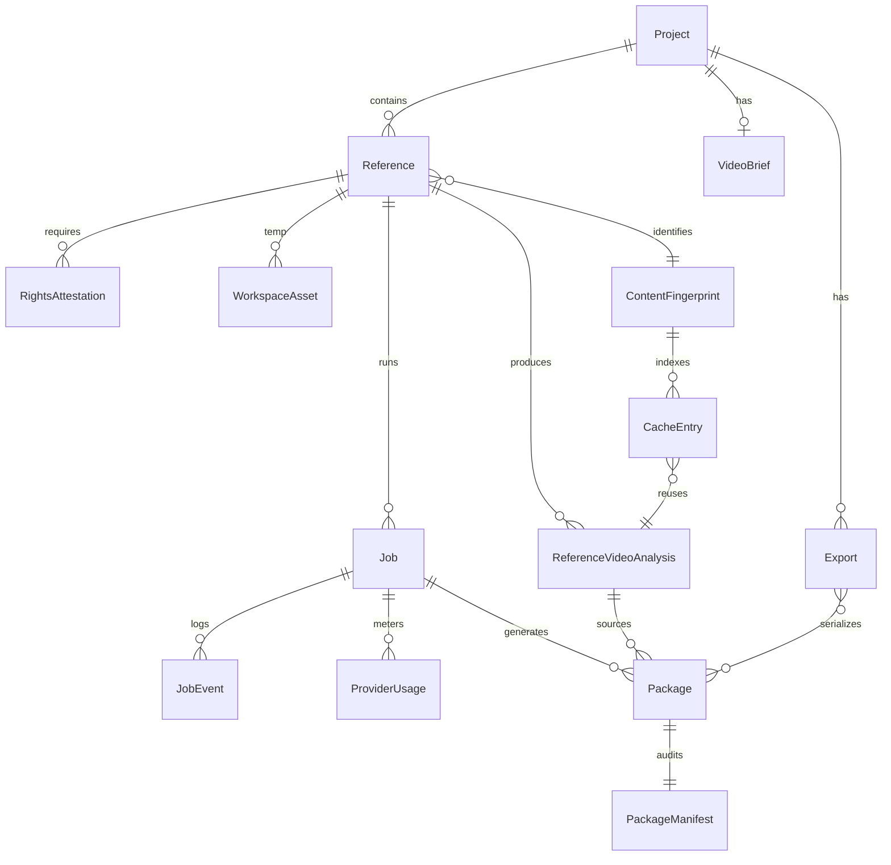

# PP-05A-2 — Entity Relationship Design

**Related:** [PP-02 ERM](../pp-02/02-entity-relationship-model.md) · [05a-1-domain-to-persistence-mapping.md](05a-1-domain-to-persistence-mapping.md)

Conceptual entity relationships for persistence design. **No tables. No SQL.**

---

## 1. Primary hierarchy

```text
User (auth.users)
    │
    └── Profile
            │
            └── Project ──────────────────────────────┐
                    │                                  │
                    ├── Video Brief (0..1 legacy)      │
                    │                                  │
                    └── Reference (0..N)               │
                            │                          │
                            ├── RightsAttestation (1..N)
                            ├── WorkspaceAsset (0..N, temp)
                            │
                            ├── ContentFingerprint (1..N over time)
                            │         │
                            │         └── CacheEntry (0..N)
                            │                   │
                            │                   └──► ReferenceVideoAnalysis (reuse link)
                            │
                            ├── Job (0..N)
                            │       │
                            │       ├── JobEvent (0..N)
                            │       ├── ProviderUsage (0..N)
                            │       │
                            │       └──► (produces) ReferenceVideoAnalysis
                            │       └──► (produces) Package
                            │
                            ├── ReferenceVideoAnalysis (0..N versions)
                            │       │
                            │       └── Package (0..N per type/version)
                            │               │
                            │               └── PackageManifest (1:1 audit)
                            │
                            └── Export (0..N)
                                    │
                                    └── package ID references (N:M logical)
```

---

## 2. Workspace (non-entity)

```text
Workspace (UI read scope)
    │
    reads ► Project
    reads ► Reference (latest / selected)
    reads ► ReferenceVideoAnalysis (latest / selected version)
    reads ► Package[] (by analysis)
    reads ► Job (active + history)
    reads ► Video Brief (legacy)
    reads ► Engine evaluations (computed — not persisted as analysis)
```

Workspace has **no persistence root** — composed by Workspace Composer / repository reads.

---

## 3. Cardinality matrix

| From | To | Cardinality | Rule |
|---|---|---|---|
| Project | Reference | 1:N | Multiple references over project lifetime |
| Project | Video Brief | 1:0..1 | Legacy wizard |
| Reference | ReferenceVideoAnalysis | 1:N | Re-analysis creates new version |
| Reference | Job | 1:N | Retries create new jobs |
| ReferenceVideoAnalysis | Package | 1:N | Multiple types + versions |
| Package | PackageManifest | 1:1 | Audit slice of envelope |
| Job | ReferenceVideoAnalysis | 1:0..1 | Per job run (cache hit may reuse existing) |
| Job | Package | 1:0..N | Via `createdByJobId` |
| Job | JobEvent | 1:N | Append-only |
| Job | ProviderUsage | 1:N | Optional per AI call |
| ContentFingerprint | CacheEntry | 1:N | History of entries; one active per scope |
| CacheEntry | ReferenceVideoAnalysis | N:1 | Points to cached snapshot |
| Fingerprint | ReferenceVideoAnalysis | 1:N | Same content may link multiple analysis versions if re-run |
| Project | Export | 1:N | |
| Export | Package | N:M | By ID list — logical, not join entity in MVP |
| Reference | WorkspaceAsset | 1:N | Temp uploads |

---

## 4. Cache relationship (persistence view)

```text
Reference
    │
    ▼
ContentFingerprint (scoped: user/project per policy)
    │
    ├── CacheEntry (active, TTL)
    │         │
    │         └──► ReferenceVideoAnalysis (analysisId)
    │
    └── CacheEntry (invalidated/expired — retained for audit optional)
```

Per-user default scope (PP-02): cache entries **not shared across users** until legal approval.

---

## 5. Provider usage relationship

```text
Job ──► ProviderUsage[] ──► (aggregates to) Project / User credit ledger (PP-18)
```

ProviderUsage is **append-only** — not part of analysis or package payloads.

---

## 6. Deterministic engines (unchanged from PP-02)

```text
Video Brief ──► Scene Decomposition ──┐
                                      ├──► NOT stored as ReferenceVideoAnalysis
ReferenceVideoAnalysis ───────────────┘
                                      │
                                      └──► optional Package inputs (by reference ID)
```

Engine outputs remain **computed** unless explicitly copied into Package payload at generation time.

---

## 7. Relationship diagram (Mermaid)



---

## Step 05A-2 acceptance

- [x] Conceptual ERM documented
- [x] Workspace positioned as read model
- [x] No tables or SQL
