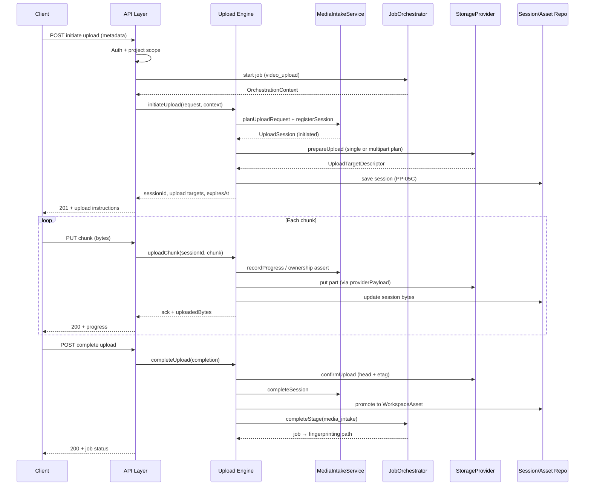
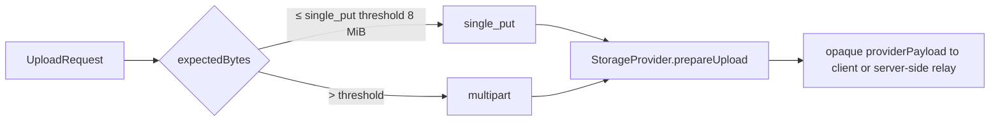
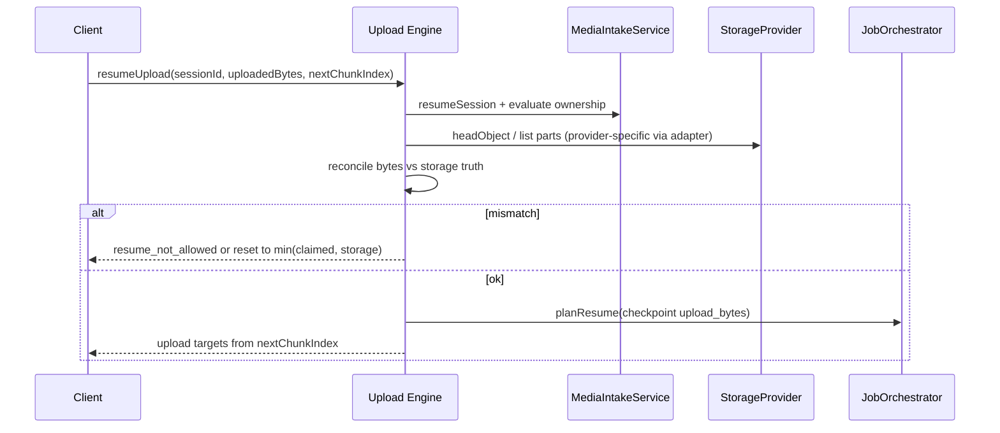
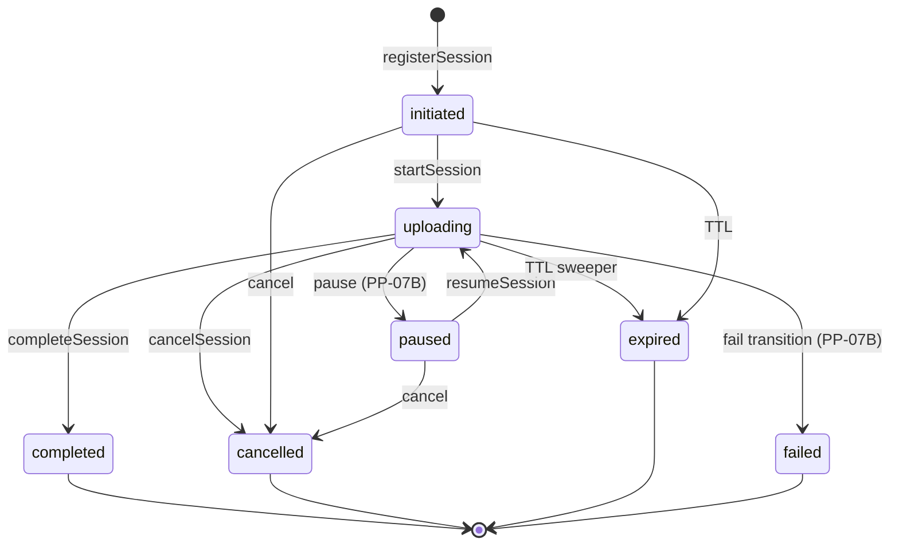
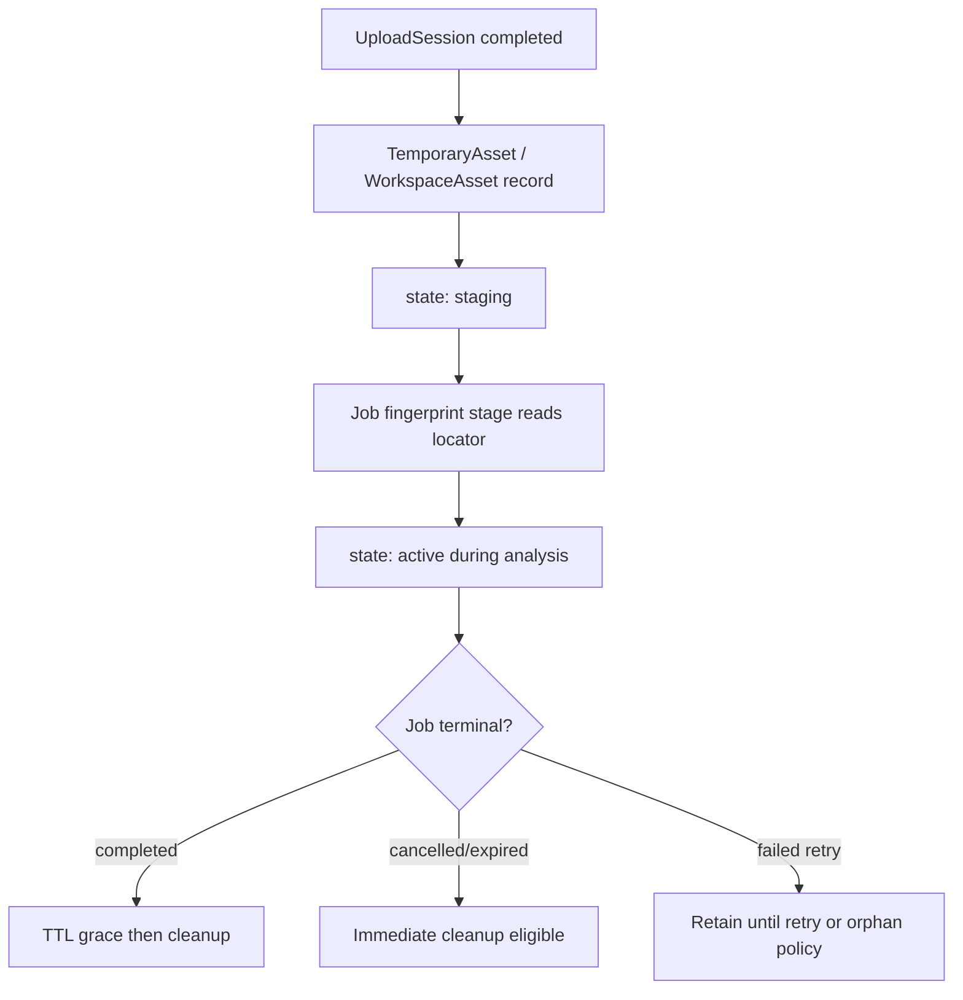
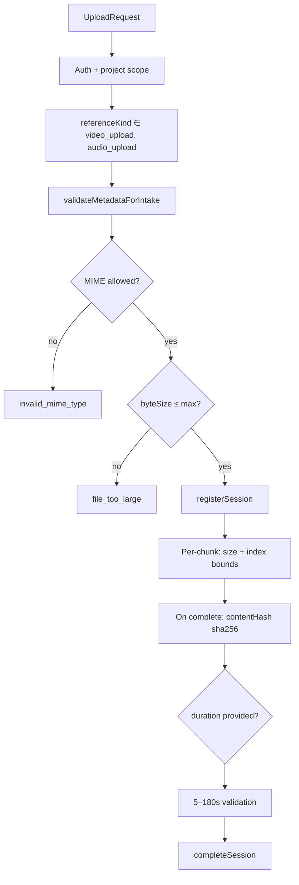
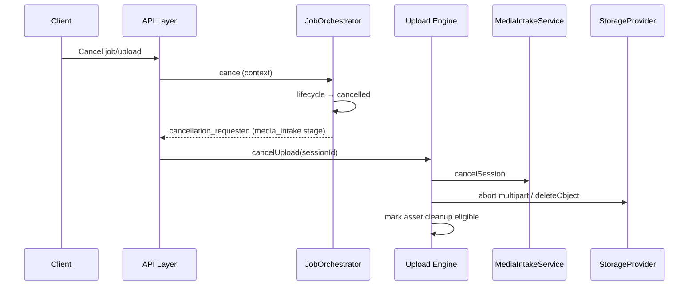

# PP-07B-A — Upload Engine Design Audit

**Phase:** Design only  
**Status:** COMPLETE (pending approval)  
**Rule:** No production upload code, HTTP, storage SDKs, SQL, workers, or UI.

**Related:** [PP-07 contracts](../pp-07/README.md) · [PP-08 orchestrator](../pp-08/README.md) · [PP-04B pipeline](../pp-04/04b-end-to-end-runtime-pipeline.md) · [PP-05A persistence](../pp-05a/README.md)

---

## 1. Upload request lifecycle

### Actors

| Actor | Responsibility |
|-------|----------------|
| Client | Initiates upload, sends chunks, polls progress |
| API layer | Auth, project ownership, DTO validation, invokes Upload Engine |
| Upload Engine | Coordinates session + storage; no pipeline job logic |
| `MediaIntakeService` | Pure session planning and transitions (PP-07) |
| `JobOrchestrator` | `media_intake` stage; lifecycle states `preparing` → `uploading` |
| `StorageProvider` | Prepare/confirm/delete objects (adapter, PP-07B) |
| Repositories (PP-05C) | Persist session + workspace asset metadata |

### End-to-end sequence



### Request phases

| Phase | Session state | Job state (orchestrator) | Client action |
|-------|---------------|--------------------------|---------------|
| Initiate | `initiated` | `created` → `preparing` (via stage handoff) | Send metadata only |
| Start transfer | `uploading` | `uploading` | First chunk or explicit start |
| In progress | `uploading` | `uploading` (progress 10–15%) | Chunks |
| Pause (optional) | `paused` | `uploading` | User pause — PP-07B |
| Complete | `completed` | transitions to `fingerprinting` | Finalize + hash |
| Cancel | `cancelled` | `cancelled` | Abort |
| Expire | `expired` | `expired` or `failed` | TTL exceeded |
| Fail | `failed` | `failed` / `retry_pending` | Unrecoverable error |

### Idempotency

| Operation | Key | Behavior |
|-----------|-----|----------|
| Initiate | `(projectId, referenceId, clientRequestId?)` | Optional client idempotency key prevents duplicate sessions |
| Chunk upload | `(sessionId, chunkIndex)` | Same index + matching hash → ack without double-write |
| Complete | `(sessionId, contentHash)` | Terminal; duplicate complete returns existing result |

---

## 2. Chunked upload strategy

### Default parameters

| Parameter | Default | Source |
|-----------|---------|--------|
| Chunk size | 5 MiB (5_242_880 bytes) | Upload Engine config; overridable per request within bounds |
| Min chunk size | 256 KiB | Prevent excessive part count |
| Max chunk size | 32 MiB | Provider limit alignment |
| Max parts | 10_000 | Multipart safety cap |
| Max file size | 500 MiB | `src/domain/media/constants.ts` |

### Modes



| Mode | When | Storage contract |
|------|------|------------------|
| **single_put** | Small files ≤ 8 MiB (configurable) | One signed URL or server-side stream |
| **multipart** | Larger files | `UploadTargetDescriptor.mode: 'multipart'` + part plan in `providerPayload` |

### Chunk index model

- Chunks are **0-based** indexed; `nextChunkIndex` on `UploadResume` aligns with PP-07 contract.
- `uploadedBytes` must equal sum of acknowledged chunk sizes (monotonic).
- Final chunk may be smaller than `chunkSizeBytes`.
- Server validates: `uploadedBytes ≤ expectedBytes`, chunk index sequential (allow retry of same index).

### Server-side vs client-direct

| Pattern | MVP recommendation | Rationale |
|---------|---------------------|-----------|
| Client → signed URL (direct to storage) | **Preferred for MVP** | Offloads bandwidth; PP-05A security model |
| Client → API → storage (relay) | Dev/localhost fallback | Simpler debugging; higher server cost |

Upload Engine returns **targets** from `prepareUpload`; it does not embed provider SDK details in API responses (G-29).

---

## 3. Resume protocol

### Triggers

| Trigger | Owner |
|---------|-------|
| Client disconnect mid-upload | Client re-initiates with `UploadResume` |
| Worker/orchestrator crash | Job remains `uploading`; client or new worker resumes |
| Browser refresh | Client stores `sessionId` + last acked `chunkIndex` |

### Resume flow



### Reconciliation rules

1. Load session from repository; reject if terminal or expired.
2. `canResumeUploadSession`: state must be `uploading` or `paused`.
3. Compare `UploadResume.uploadedBytes` with storage `headObject` / multipart listing.
4. **Storage wins** on conflict — client adjusts to provider-reported offset.
5. Job checkpoint `upload_bytes` (PP-06) must align — orchestrator `planResume` sets stage to `media_intake`.
6. Multipart: provider adapter returns completed part indices; engine sets `nextChunkIndex = max(completed) + 1`.

### Orchestrator alignment

- PP-08 today: `planResume` publishes `resume_planned` only.
- PP-07B: extend `OrchestrationContext` with optional `uploadSessionId` (design — not implemented in PP-07B-A).
- Upload resume does **not** create a new job (G-22 exception).

---

## 4. Upload session lifecycle

### State machine (existing PP-07)



### Engine gaps to close in PP-07B

| Transition | PP-07 status | PP-07B action |
|------------|--------------|---------------|
| `pause` | Declared, not in engine | Add `pauseUploadSession` |
| `expire` | Declared, not in engine | Sweeper invokes expire |
| `fail` | Declared, not in engine | Map storage/validation errors |

### TTL

- Session `expiresAt`: 24h from registration (`DEFAULT_EXPIRATION_POLICY`).
- Signed upload URL TTL: 60 minutes — refresh via `prepareUpload` on resume.
- Incomplete uploads: delete storage parts + mark session `expired`.

---

## 5. Temporary asset lifecycle

### From upload completion to pipeline input



| Stage | Asset state | Storage |
|-------|-------------|---------|
| Upload complete | `staging` | Object confirmed in bucket |
| Fingerprint start | `active` | Locator passed to fingerprint service |
| Job cancelled before analysis | `expired` / delete | Sweeper removes object |
| Job completed | `active` → cleanup per `CleanupPolicy` | Post-job grace 1h |

**G-29:** `StorageLocator` never exposed to client — only opaque handles/session IDs in API.

---

## 6. Storage provider interaction model

### Interface (existing)

```typescript
// src/domain/media/storage/storage-provider.ts — contracts only today
StorageProvider {
  prepareUpload(request) → ObjectPutResult   // plan + providerPayload
  confirmUpload(scope)   → ObjectHeadResult  // verify size/etag
  headObject(request)    → ObjectHeadResult  // resume reconciliation
  deleteObject(request)  → ObjectDeleteResult
  listExpiredObjects(before) → StorageLocator[]
}
```

### Interaction per upload phase

| Phase | Storage call | Rollback |
|-------|--------------|----------|
| Initiate | `prepareUpload` | None — no bytes yet |
| Each chunk | Put via `providerPayload` (client or relay) | Abort multipart on cancel |
| Complete | `confirmUpload` + `headObject` | If confirm fails → session `failed`, delete parts |
| Cancel | `deleteObject` or abort multipart | Best-effort; log if orphan |
| Expire sweeper | `listExpiredObjects` + `deleteObject` | Metadata delete after storage |

### Adapter requirements (PP-07B)

| Requirement | Detail |
|-------------|--------|
| Provider ID | e.g. `supabase-storage`, `r2` — registered in `StorageProviderRegistry` |
| Scoped paths | `{projectId}/{referenceId}/{sessionId}/...` — no cross-tenant paths |
| Multipart | Map chunk index → part number; opaque `providerPayload` |
| No locator leakage | API returns upload URLs/tokens, not raw bucket keys |

---

## 7. Validation pipeline



| Gate | When | Service |
|------|------|---------|
| Metadata | Initiate | `MediaValidationService` |
| Ownership | Every operation | `MediaOwnershipService.assertScope` |
| Chunk bounds | Each chunk | Upload Engine |
| Content hash | Complete | Required sha256 hex (64 chars) |
| Duration | Complete (optional) | `MediaValidationPolicy` |

---

## 8. Security and ownership boundaries

| Rule | Implementation |
|------|----------------|
| G-01 | API layer: auth only — validation delegated |
| G-29 | No `StorageLocator` in API responses |
| Tenant isolation | `MediaOwnerScope` on every session/asset operation |
| Signed URLs | Scoped to object key + short TTL + HTTP method PUT |
| RLS (PP-05C) | `workspace_assets.project_id = auth project` |
| Rate limits | Per-user/project upload initiation (PP-07B config) |
| Content type | Allow-list MIME — reject mismatch on confirm via `headObject` |
| Size cap | Enforced at initiate + confirm |

### Threat model notes

| Threat | Mitigation |
|--------|------------|
| Cross-project session access | Ownership assert on every chunk/complete |
| Session hijack | Session bound to `ownerId`; auth token must match |
| Oversized upload | `expectedBytes` cap + confirm head check |
| Orphan storage | Sweeper + cancel cleanup |
| Hash mismatch | Reject complete if hash ≠ computed |

---

## 9. Progress reporting model

### Dual progress tracks

| Track | What | Consumer |
|-------|------|----------|
| **Upload session** | `uploadedBytes / expectedBytes` | Client poll/SSE |
| **Job progress** | `JobRecord.progressPercent` 10–15% in `uploading` | Workspace UI via job status API (future) |

### Mapping

- Upload Engine updates session bytes via `recordProgress`.
- After each chunk ack (or throttled every N chunks), Upload Engine notifies orchestrator/worker to refresh job progress — **or** worker polls session and maps linearly:

```
jobProgress = 10 + floor(5 * uploadedBytes / expectedBytes)  // 10–15% band
```

- Orchestrator does **not** compute upload bytes — Upload Engine reports; worker applies `JobTransitionRequest` if sub-state change needed.

### Client API (design)

| Endpoint (PP-07B) | Returns |
|-------------------|---------|
| GET upload status | `uploadedBytes`, `expectedBytes`, `state`, `expiresAt` |
| GET job status | `progressPercent`, `state` (separate concern) |

---

## 10. Cancellation model



### Layers

| Layer | Behavior |
|-------|----------|
| Orchestrator | Lifecycle cancel; event when `currentStageId === media_intake` |
| Upload Engine | **PP-07B:** invoke `cancelSession` + storage cleanup (closes PP-08.1 gap) |
| Client | May cancel via job API or upload session API — single authority via Upload Engine |

Partial upload artifacts deleted on cancel unless job already persisted analysis (PP-04: temp media cleaned if before analysis).

---

## 11. Error model

### Existing codes (reuse)

From PP-07 `MEDIA_INTAKE_ERROR_CODES` — do not invent parallel HTTP-specific enums without mapping.

| Code | HTTP (design) | Retryable |
|------|---------------|-----------|
| `validation_error` | 400 | No |
| `ownership_violation` | 403 | No |
| `invalid_mime_type` | 415 | No |
| `file_too_large` | 413 | No |
| `session_terminal` | 409 | No |
| `resume_not_allowed` | 409 | No |
| `storage_unavailable` | 503 | Yes |
| `session_not_found` | 404 | No |

### Job failure mapping

| Upload error | JobFailure.code | Category |
|--------------|-----------------|----------|
| Storage outage | `storage_error` | infrastructure |
| TTL exceeded | `timeout` | infrastructure |
| Validation | `file_too_large` / etc. | validation |
| User cancel | (none — job `cancelled`) | — |

Upload Engine returns `MediaIntakeResult` / mapped API errors; orchestrator `propagateFailure` for stage failures.

---

## 12. Integration with PP-08 Orchestrator

### Current state (PP-08.1)

| Integration | Status |
|-------------|--------|
| Stage in plan for `video_upload` / `audio_upload` | ✅ |
| `delegatePort: media_intake` | ✅ |
| Cancel event on `media_intake` stage | ✅ |
| `planResume` → `upload_bytes` checkpoint | ✅ |
| `MediaIntakeService` method calls | ❌ event-only |

### PP-07B orchestrator extensions (design)

```typescript
// Design addition to OrchestrationContext — PP-07B, not PP-07B-A
type OrchestrationContext = {
  // ... existing fields
  uploadSessionId?: EntityId;  // bound when media_intake starts
};
```

| Event | When |
|-------|------|
| Worker receives `stage_delegated` for `media_intake` | Bind session or wait for client initiate |
| Upload complete | Worker calls `orchestrator.completeStage({ stageId: media_intake, outcome: success })` |
| Upload fail | Worker calls `propagateFailure` or failed `completeStage` |
| Cancel | Orchestrator cancel → Upload Engine `cancelUpload(sessionId)` |

### Sequence ownership

**Orchestrator coordinates; Upload Engine executes upload work.** Neither duplicates the other's responsibility.

---

## 13. Future PP-05C persistence interaction

### Entities

| Entity | Repository (PP-05B interface) | PP-05C status |
|--------|--------------------------------|---------------|
| `UploadSession` | Design: `UploadSessionRepository` (to add in PP-07B/05C) | No table yet |
| `WorkspaceAsset` | `WorkspaceAssetRepository` | SQL exists; adapter deferred |
| `MediaLifecycleEvent` | Append-only event store | Deferred |

### Transaction boundaries

| Operation | Tx scope |
|-----------|----------|
| Complete upload | `confirmUpload` success → insert `WorkspaceAsset` + update session `completed` (single UoW) |
| Cancel | Update session → enqueue storage delete (outbox acceptable) |
| Job + session create | Reference + Job (orchestrator) separate from session register |

### Until PP-05C ships

Upload Engine MAY use in-memory or ephemeral session store for localhost acceptance — **must** implement repository ports behind interfaces so PP-05C swaps without API changes.

---

## 14. Testing strategy

### PP-07B-A (this phase)

- Document review + contract alignment checklist only.

### PP-07B unit tests

| Area | Approach |
|------|----------|
| Chunk index validation | Pure functions: bounds, monotonic bytes |
| Resume reconciliation | Mock `StorageProvider.headObject` vs client claim |
| Idempotent chunk ack | Same index twice → single storage write |
| Validation pipeline | Existing `tests/media/*` extended |
| Cancel cleanup | Mock storage delete called |

### PP-07B integration tests

| Scenario | Method |
|----------|--------|
| Happy path single_put | Mock storage adapter |
| Multipart 3 chunks | Mock multipart plan |
| Resume after disconnect | Pause at chunk 2, resume from 2 |
| Cancel mid-upload | Session cancelled + delete invoked |
| Ownership violation | Wrong project → 403 |
| Orchestrator handoff | Mock orchestrator `completeStage` called on complete |

### PP-07B contract tests

- `UploadSession` schema round-trip with repository DTOs.
- Error code → HTTP status mapping table driven tests.

### E2E (post PP-07B + PP-05C)

- Localhost: real file upload against dev storage bucket.
- Job progress 10→15% during upload.

**No upload runtime tests in PP-07B-A.**

---

## 15. Risks and deferred work

### Risks

| Risk | Impact | Mitigation |
|------|--------|------------|
| Session persistence lag (PP-05C) | Resume broken across restarts | In-memory OK for dev; prioritize session repo with PP-07B |
| Orchestrator context missing sessionId | Cancel doesn't cleanup storage | PP-07B context extension |
| Multipart provider differences | Resume bugs | Adapter conformance tests |
| Bandwidth via API relay | Cost/scaling | Prefer signed URL direct upload |
| Orphan multipart parts | Storage cost | Sweeper + cancel abort |
| Dual progress sources drift | UI confusion | Single upload status API; job progress derived |

### Deferred work

| Item | Phase |
|------|-------|
| HTTP endpoints | PP-07B |
| Storage SDK adapters | PP-07B |
| `pause` / `expire` / `fail` engine transitions | PP-07B |
| `UploadSessionRepository` | PP-07B / PP-05C |
| Orchestrator `uploadSessionId` on context | PP-07B |
| Virus scan / quarantine | Post-MVP |
| Worker job claim loop | Worker boundary |
| SSE progress stream | PP-07B or UI phase |
| Client-side encryption | Out of scope |

---

## Design acceptance checklist

- [x] Reuses PP-07 types without redefinition
- [x] Respects PP-08 orchestrator coordination model
- [x] Aligns with PP-04B pipeline and PP-06 upload resume checkpoint
- [x] Storage via `StorageProvider` only — no SDK in domain
- [x] G-29 locator opacity preserved
- [x] PP-05C persistence boundaries documented
- [x] No production upload code in PP-07B-A
