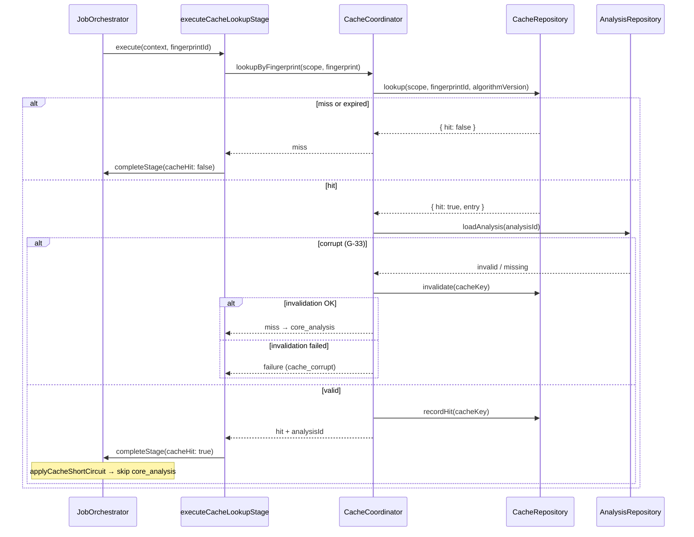

# PP-09A — Cache Layer Design Audit

**Phase:** Design only  
**Status:** COMPLETE (PP-09A.1 hardening applied)  
**Rule:** No Cache Service runtime, no orchestrator wiring changes, no HTTP, no Core Analysis, no workers, no UI.

**Related:** [PP-02 cache architecture](../pp-02/08-cache-architecture.md) · [PP-04C service boundaries](../pp-04/04c-service-boundaries.md) · [PP-04B pipeline](../pp-04/04b-end-to-end-runtime-pipeline.md) · [PP-05C persistence](../pp-05c/README.md) · [PP-08 orchestrator](../pp-08/README.md) · [PP-05 LinkMetadataCache](../pp-05/05-link-intelligence-design-audit.md) · [PP-09A.1 hardening](09a1-cache-layer-design-hardening.md)

---

## Executive summary

The **Analysis Cache Layer** reuses persisted `ReferenceVideoAnalysis` snapshots keyed by **Content Fingerprint**, avoiding duplicate Core Analysis when the same content identity was analyzed before within the **same user scope**.

PP-08 already implements orchestrator **stage planning** for `cache_lookup`, **cache-hit short-circuit** (`core_analysis` skipped), and **job state jumps** to `generating_packages`. PP-05C already implements **`CacheRepository`** and **`cache_entries`** with per-user RLS. **What is missing** is the **Cache Service** — the domain delegate that performs lookup, hit recording, corrupt validation, invalidation, and (on the write path) entry creation after analysis.

PP-09B will implement `CacheCoordinator` + `CachePort` + `executeCacheLookupStage` following the same pattern as Link Intelligence (PP-05B): orchestrator owns workflow; coordinator owns cache mechanics; repository owns persistence.

**Two cache layers must remain separate:**

| Layer | Key | Owner | Storage (PP-09B scope) |
|-------|-----|-------|------------------------|
| **LinkMetadataCache** | canonical URL + provider + version | Link Intelligence | Optional adapter — **not** PP-09B primary deliverable |
| **Analysis cache** | fingerprint + algorithm version + user scope | Cache Service | `CacheRepository` / `cache_entries` |

---

## 1. Cache architecture

### 1.1 Component model

```text
┌─────────────────────────────────────────────────────────────────┐
│                     JobOrchestrator (PP-08)                      │
│  Plans stages · delegates cache_lookup · completeStage           │
└───────────────────────────────┬─────────────────────────────────┘
                                │
                                ▼
┌─────────────────────────────────────────────────────────────────┐
│              executeCacheLookupStage (PP-09B runner)             │
│  Thin workflow glue — no cache logic                             │
└───────────────────────────────┬─────────────────────────────────┘
                                │
                                ▼
┌─────────────────────────────────────────────────────────────────┐
│                   CacheCoordinator (PP-09B)                      │
│  Key build · lookup · corrupt check · recordHit · invalidate     │
└───────────────────────────────┬─────────────────────────────────┘
                                │
                                ▼
┌─────────────────────────────────────────────────────────────────┐
│              CacheRepository (PP-05C — exists)                   │
│  lookup · put · recordHit · invalidate                           │
└───────────────────────────────┬─────────────────────────────────┘
                                │
                                ▼
                         cache_entries (+ content_fingerprints FK)
```

### 1.2 Responsibility boundaries

| Component | Owns | Must never |
|-----------|------|------------|
| **JobOrchestrator** | Stage progression, `applyCacheShortCircuit`, failure propagation | Perform cache I/O; skip packages on hit (G-15) |
| **CacheCoordinator** | Lookup semantics, key composition, corrupt detection, hit stats | Advance job state; call Core Analysis on hit path |
| **CacheRepository** | CRUD on `cache_entries` | Validate analysis payload; orchestrate pipeline |
| **Core Analysis (PP-10)** | Produce analysis on miss | Read cache on hit path |
| **Package Engine (PP-13)** | Generate packages from analysis | Access cache directly |

### 1.3 Reference to existing orchestrator behavior (PP-08)

Already implemented — PP-09B **must not redefine**:

- `cache_lookup` stage in `PIPELINE_STAGE_IDS` after `fingerprint`
- `StageCompletion.cacheHit` drives `applyCacheShortCircuit(plan)` → adds `core_analysis` to `skippedStageIds`
- Cache hit → job transitions to `generating_packages`; next stage `package_generation` (G-15: packages **not** skipped)
- Cache miss → remain in `fingerprinting`; next stage `core_analysis`

---

## 2. Cache service boundaries

Aligned with [PP-04C §5](../pp-04/04c-service-boundaries.md):

| Field | Design |
|-------|--------|
| **Purpose** | Lookup and write analysis cache entries keyed by fingerprint |
| **Consumes** | `fingerprintId`, `fingerprintAlgorithmVersion`, `OwnerScope`, optional analysis snapshot (write path) |
| **Produces** | `{ hit, analysisId?, cacheKey?, corrupt? }` |
| **Must never do** | Regenerate analysis on hit; expose cross-user entries; skip package generation |
| **Allowed dependencies** | `CacheRepository`, `AnalysisRepository` (read-only validate on hit — PP-10) |
| **Forbidden dependencies** | Core Analysis (hit path), Package Engine, Link Intelligence fetch, raw media |

### 2.1 Read path vs write path

| Path | Trigger | Cache Service operation |
|------|---------|-------------------------|
| **Read (lookup)** | `cache_lookup` stage | `lookupByFingerprint(scope, fingerprint)` |
| **Write (populate)** | After successful `core_analysis` (PP-10) | `writeEntry(scope, fingerprint, analysis)` |

PP-09B implements **read path + coordinator helpers for write**. Full write wiring lands with PP-10 (analysis producer).

---

## 3. Cache port and interfaces (design only)

### 3.1 Orchestrator delegate port

Add to `src/server/orchestration/ports.ts` in PP-09B:

```typescript
/** Orchestrator delegate port — PP-09B. */
export type CacheLookupRequest = {
  jobId: EntityId;
  projectId: EntityId;
  ownerId: EntityId;
  referenceId: EntityId;
  fingerprintId: EntityId;
  fingerprintAlgorithmVersion: MonotonicVersion;
  requestedAt: IsoDateTime;
};

export type CacheLookupOutcome = {
  hit: boolean;
  analysisId?: EntityId;
  cacheKey?: string;
  /** True when entry existed but analysis validation failed (G-33). */
  corrupt?: boolean;
};

export type CachePort = {
  lookup(request: CacheLookupRequest): Promise<OrchestrationResult<CacheLookupOutcome>>;
};
```

**DI token:** extend `ORCHESTRATION_PORT_TOKENS` with `cache: Symbol.for('prompt-pilot.cache.CachePort')` — mirrors existing `STAGE_PORT_IDS` entry `'cache'`.

### 3.2 Cache coordinator interface (server)

```typescript
export type CacheCoordinator = {
  lookupByFingerprint(input: CacheLookupInput): Promise<CacheResult<CacheLookupOutcome>>;
  recordHit(scope: OwnerScope, cacheKey: string): Promise<CacheResult<void>>;
  invalidate(scope: OwnerScope, cacheKey: string, reason: CacheInvalidationReason): Promise<CacheResult<void>>;
  buildCacheKey(input: CacheKeyInput): string;
  writeEntry(input: CacheWriteInput): Promise<CacheResult<CacheEntryRecord>>; // PP-10 consumer
};
```

### 3.3 Distinction from persistence token

| Token | Layer | Exists today |
|-------|-------|--------------|
| `PERSISTENCE_TOKENS.cacheRepository` | Repository adapter | Yes (PP-05C) |
| `ORCHESTRATION_PORT_TOKENS.cache` | Orchestrator delegate | **No — PP-09B** |

Orchestrator and workers must depend on **CachePort**, not `CacheRepository` directly (same rule as Link Intelligence vs raw fetch).

---

## 4. Cache key composition

### 4.1 Canonical formula (PP-09B)

```text
cacheKey = `${fingerprintAlgorithmVersion}:${fingerprintId}:${scopeUserId}`
```

| Segment | Source | Notes |
|---------|--------|-------|
| `fingerprintAlgorithmVersion` | `ContentFingerprint.fingerprintAlgorithmVersion` | G-32: bump invalidates semantic compatibility |
| `fingerprintId` | Active fingerprint row | FK in `cache_entries` |
| `scopeUserId` | `OwnerScope.ownerId` | G-31 per-user default |

**Properties:**

- Deterministic and unique per (fingerprint, algorithm version, user)
- Matches `CacheRepository.lookup` query dimensions (`fingerprint_id`, `scope_user_id`) plus algorithm version guard on fingerprint row
- Primary key `cache_key` in `cache_entries` — no hash collision domain

### 4.2 Fields stored on entry (PP-05C contract)

From `CacheEntryRecord` (`src/server/persistence/contracts/records.ts`):

| Field | Role |
|-------|------|
| `cacheKey` | Primary lookup key |
| `fingerprintId` | Foreign key + lookup index |
| `analysisId` | Cached snapshot reference |
| `analysisVersion` | Monotonic analysis version pinned |
| `pipelineVersion` | Core Analysis pipeline semver |
| `scopeUserId` | Tenant isolation |
| `expiresAt` | TTL enforcement |
| `hitCount`, `lastHitAt` | Observability |
| `invalidatedAt` | Soft invalidation |

### 4.3 TTL policy (design default)

| Policy | Value | Rationale |
|--------|-------|-----------|
| Default TTL | 90 days | PP-02 long-lived analysis reuse |
| Config surface | `CACHE_CONFIG.defaultTtlSeconds` | Env override in PP-09B |
| Expired entries | Treated as miss; optional background purge deferred |

---

## 5. Fingerprint-driven lookup flow

### 5.0 Upstream fingerprint runtime dependency (PP-09A.1)

PP-09B **depends on** fingerprint outputs bound on `OrchestrationContext` **before** `cache_lookup`:

| Required context field | Source |
|----------------------|--------|
| `fingerprintId` | Active `ContentFingerprint` row |
| `fingerprintAlgorithmVersion` | Same fingerprint record (G-32) |

**Current gap:** The `fingerprint` pipeline stage exists in PP-08 stage planning, but **no fingerprint delegate / stage runner is implemented** and `OrchestrationContext` does not yet bind `fingerprintId`. PP-09B does **not** implement fingerprint computation or persistence.

**Until fingerprint runtime exists**, PP-09B approved strategies:

1. **Test doubles** — inject fixture `fingerprintId` + version in unit and orchestration tests (primary).
2. **Temporary integration stub** — composition-root stub for local integration tests only (not production).

See [09a1-cache-layer-design-hardening.md](09a1-cache-layer-design-hardening.md).

### 5.1 Preconditions (G-30)

Cache lookup runs **only after** `fingerprint` stage completes with an **active** `ContentFingerprint` bound on orchestration context (`fingerprintId` + algorithm version — context field extension in PP-09B).

Fingerprint stage must run before `cache_lookup` — enforced by stage planner `dependsOn: ['fingerprint']`.

### 5.2 Lookup algorithm

```text
1. Validate OwnerScope matches job context
2. Build cacheKey from fingerprintId + algorithmVersion + ownerId
3. CacheRepository.lookup(scope, fingerprintId, algorithmVersion)
   └── G-32: repository returns miss if fingerprint algorithm version mismatch
4. If miss → return { hit: false }
5. If hit → load analysis by analysisId (AnalysisRepository — PP-10)
6. Validate analysis (G-33 — existence; full schema when PP-10 available)
   └── fail → invalidate(cacheKey)
       ├── invalidation OK → return { hit: false } (cache miss → core_analysis)
       └── invalidation FAIL → propagate job failure code cache_corrupt
7. CacheRepository.recordHit(scope, cacheKey)
8. Return { hit: true, analysisId, cacheKey }
```

### 5.3 Sequence diagram — cache lookup stage



---

## 6. Cache hit / miss lifecycle

### 6.1 Hit path

| Step | System behavior |
|------|-----------------|
| 1 | `cache_lookup` completes with `cacheHit: true` |
| 2 | Orchestrator applies `applyCacheShortCircuit` — `core_analysis` → `skippedStageIds` |
| 3 | Job state → `generating_packages` (multi-hop from `fingerprinting`) |
| 4 | Next stage → `package_generation` (G-15) |
| 5 | `JobRecord.cacheHit = true` on transition (optional context binding) |
| 6 | Analysis loaded from cache — **not** re-analyzed |

### 6.2 Miss path

| Step | System behavior |
|------|-----------------|
| 1 | `cache_lookup` completes with `cacheHit: false` |
| 2 | No short-circuit; `core_analysis` remains in plan |
| 3 | Job stays / returns to analysis-ready state |
| 4 | Next stage → `core_analysis` (PP-10) |
| 5 | After analysis persists → `CacheCoordinator.writeEntry` (PP-10 integration) |

### 6.3 Write path (post-analysis — PP-10 integration)

```text
core_analysis success
    → persist ReferenceVideoAnalysis
    → CacheCoordinator.writeEntry({
         scope, fingerprintId, analysisId,
         analysisVersion, pipelineVersion,
         expiresAt: now + TTL
       })
    → CacheRepository.put
```

Idempotency: same `cacheKey` insert conflict → treat as update or no-op (PP-09B design choice: **upsert invalidate-then-put** or skip if active entry exists).

### 6.4 State diagram

```text
                    ┌─────────────┐
                    │  NO ENTRY   │
                    └──────┬──────┘
                           │ write (analysis complete)
                           ▼
                    ┌─────────────┐
         ┌─────────│   ACTIVE    │─────────┐
         │         └──────┬──────┘         │
    TTL expire      hit (+recordHit)   invalidate / corrupt
         │                 │                 │
         ▼                 │                 ▼
    ┌─────────┐            │          ┌─────────────┐
    │ EXPIRED │            │          │ INVALIDATED │
    │ (miss)  │            │          │   (miss)    │
    └─────────┘            │          └─────────────┘
                           │
                    (remain ACTIVE)
```

---

## 7. Cache invalidation strategy

### 7.1 Invalidation triggers

| Trigger | Action | Phase |
|---------|--------|-------|
| **G-32** algorithm version mismatch | `lookup` returns miss (repository guard) | PP-05C (exists) |
| **G-33** corrupt analysis on hit | `invalidate(cacheKey)`; if OK → **cache miss** → `core_analysis`; if fail → `cache_corrupt` job failure | PP-09B |
| **TTL expired** | Query excludes row (`expires_at > now`) | PP-05C (exists) |
| **Reference deleted** | Invalidate entries for fingerprint (hook) | PP-09B hook; full cascade PP-05C+ |
| **Manual admin** | `invalidate` API / admin tool | Deferred post-MVP |
| **User project delete** | Do **not** delete shared global entries; scope isolation prevents cross-user reads | G-31 |

### 7.2 Soft invalidation

`CacheRepository.invalidate` sets `invalidated_at` — entry remains for audit; lookup queries exclude invalidated rows (PP-05C behavior).

### 7.3 LinkMetadataCache invalidation

Separate policy — URL metadata TTL ~24h, keyed by URL not fingerprint. **Not** managed by Cache Service.

---

## 8. Orchestrator integration (`cache_lookup` stage)

### 8.1 Stage definition (existing)

From `src/domain/orchestration/stages.ts`:

| Field | Value |
|-------|-------|
| `stageId` | `cache_lookup` |
| `delegatePort` | `'cache'` |
| `dependsOn` | `['fingerprint']` |
| `jobStates` | `['fingerprinting']` |

### 8.2 PP-09B stage runner

Mirror `executeLinkIntelligenceStage`:

```typescript
export async function executeCacheLookupStage(
  orchestrator: JobOrchestrator,
  coordinator: CacheCoordinator,
  context: OrchestrationContext,
  input: CacheLookupStageInput,
): Promise<OrchestrationResult<OrchestrationOutcome>>;
```

**Flow:**

1. Read `fingerprintId` + algorithm version from context (must be bound by fingerprint stage)
2. `coordinator.lookupByFingerprint(...)`
3. On coordinator failure → `propagateFailure` with mapped `JobFailure`
4. On success → `completeStage({ stageId: 'cache_lookup', cacheHit: outcome.hit })`
5. Bind `analysisId` on context when hit (new optional field `cachedAnalysisId`)

### 8.3 Context extensions (PP-09B)

| Field | When set |
|-------|----------|
| `fingerprintId` | After `fingerprint` stage (prerequisite) |
| `cachedAnalysisId` | After cache hit |
| `cacheKey` | Optional diagnostic binding |

### 8.4 Pipeline diagram (full)

```text
validation → ownership → [link_intelligence | media_intake] → fingerprint
    → cache_lookup ──HIT──► package_generation → …
                  └──MISS──► core_analysis → (write cache) → package_generation → …
```

---

## 9. Repository boundaries

### 9.1 Existing `CacheRepository` (PP-05C)

Path: `src/server/persistence/repositories/cache-repository.ts`

| Method | Cache Service usage |
|--------|---------------------|
| `lookup` | Primary read path |
| `put` | Write path after analysis |
| `recordHit` | After successful hit validation |
| `invalidate` | Corrupt entry, explicit invalidation |

### 9.2 `SupabaseCacheRepository` behaviors to preserve

- G-32 version check on `content_fingerprints` before cache row query
- RLS: `scope_user_id = auth.uid()` — per-user rows
- Active filter: `invalidated_at IS NULL AND expires_at > now()`

### 9.3 Analysis repository (read-only on hit)

`AnalysisRepository.load` validates existence before returning hit. Missing analysis → corrupt path (G-33).

**PP-09B** may stub analysis validation if PP-10 not complete — design allows **structural-only check** (row exists) in PP-09B with **schema validation** added in PP-09B.1 or PP-10 integration.

### 9.4 What Cache Service must not do

- Direct Supabase client calls (use repository)
- SQL or migration changes (PP-05C owns DDL)
- Write fingerprint rows (Fingerprint Service / persistence coordinator)

---

## 10. Failure model

### 10.1 Canonical G-33 / `cache_corrupt` behavior (PP-09A.1)

**Corrupt analysis payload is not a job failure.** Invalidation failure is.

```text
Repository hit + analysis validation fails (G-33)
    → invalidate(cacheKey)
    → if OK:  completeStage(cacheHit: false) → core_analysis  [CACHE MISS]
    → if FAIL: propagateFailure(code: cache_corrupt)         [JOB FAILURE]
```

| Situation | `cacheHit` | Job failure code | Next stage |
|-----------|------------|------------------|------------|
| Clean miss (no entry / expired / G-32 mismatch) | `false` | — | `core_analysis` |
| Corrupt entry, invalidation succeeds | `false` | — | `core_analysis` |
| Corrupt entry, invalidation fails | — | `cache_corrupt` | failure propagation |
| Repository lookup/recordHit error | — | `storage_error` | failure propagation |
| Missing fingerprint context | — | validation mapping | failure propagation |

This matches PP-04B §5 (“Treat corrupt as miss”) while reserving `cache_corrupt` for **inability to invalidate** a bad entry.

### 10.2 Job failure codes

| Code | Category | When | Retryable |
|------|----------|------|-----------|
| `cache_corrupt` | cache | Invalidation failed after corrupt analysis detected | Yes |
| `storage_error` | infrastructure | Repository lookup/recordHit/put failure | Yes |
| validation codes | validation | Missing fingerprint context | No |

### 10.3 Port adapter error mapping

Follow Link Intelligence pattern (PP-05B.1): preserve `jobFailureCode` on orchestration errors when port adapter wraps coordinator failures.

### 10.4 Orchestration events

| Event | When |
|-------|------|
| `stage_completed` | Lookup completes (hit or miss) |
| `stage_failed` | Unrecoverable repository / scope error |
| `cache_hit` / `cache_miss` | **Deferred** — optional domain event in PP-09B.1 |

---

## 11. Security and tenant isolation

### 11.1 G-31 per-user scope (default)

- Every cache row includes `scope_user_id = ownerId`
- Lookup always passes `OwnerScope` from job context
- Repository rejects `put` when `input.scopeUserId !== scope.ownerId`
- **No cross-user cache reads** in MVP

### 11.2 Global cache sharing

**Explicitly deferred** until legal approval (PP-02). Design leaves room for optional `scopeMode: 'global'` dimension in key formula — **not implemented in PP-09B**. Global sharing is out of scope for PP-09A/09B; see roadmap Phase 13b (PP-09B) deferred items.

### 11.3 RLS enforcement

Database RLS on `cache_entries` (PP-05C migration) is the authoritative tenant boundary. Cache Service must never accept client-supplied `scopeUserId` that differs from authenticated job owner.

### 11.4 Analysis payload exposure

Cache hit returns **`analysisId` only** through orchestrator context — not full analysis blob through port. Downstream stages load via Analysis Repository under same scope.

---

## 12. LinkMetadataCache interaction

| Aspect | LinkMetadataCache | Analysis cache |
|--------|-------------------|----------------|
| Purpose | Avoid repeat oEmbed/API | Avoid repeat Core Analysis |
| Key | URL + provider + version | Fingerprint + algorithm + user |
| Stage | `link_intelligence` | `cache_lookup` |
| Repository | Dedicated adapter (PP-09 optional) | `CacheRepository` |
| PP-09B scope | **Out of scope** (port only) | **In scope** |

No shared storage table. No unified cache manager class.

---

## 13. Testing strategy

### 13.1 PP-09B unit tests (`tests/cache/`)

| Area | Cases |
|------|-------|
| Key composition | Deterministic key; version segment; user segment |
| Coordinator lookup | Hit, miss, expired, invalidated |
| G-33 corrupt | Invalid analysis → invalidate + miss |
| G-32 mismatch | Algorithm version mismatch → miss |
| Scope violation | Wrong owner → error |
| recordHit | Increments hit count |

### 13.2 Orchestration integration (`tests/orchestration/`)

| Area | Cases |
|------|-------|
| `executeCacheLookupStage` | Hit → `cacheHit: true`, short-circuit |
| Miss | `cacheHit: false`, `core_analysis` next |
| Failure propagation | Repository error → job failure |

Extend existing `defaultJobOrchestrator.spec.ts` cache-hit test (currently manual `completeStage` only) with coordinator-backed runner test in PP-09B.

### 13.3 Persistence integration

Reuse `tests/persistence/supabaseIntegration.spec.ts` patterns for repository — **already covers PP-05C**. PP-09B adds service-layer tests with in-memory `CacheRepository` fake.

### 13.4 Regression

Full `npm test` + typecheck on every PP-09B PR.

### 13.5 Verification script (PP-09B)

```bash
npm run verify:cache:local   # new script — mirror verify:auth:local
```

---

## 14. Risks and deferred work

### 14.1 Risks

| Risk | Mitigation |
|------|------------|
| Corrupt cache causes silent re-analysis cost | G-33 invalidate + metrics on corrupt count |
| Fingerprint collision (theoretical) | Algorithm version + identity descriptor uniqueness — monitor |
| Write path race (two jobs, same fingerprint) | Idempotent put / unique constraint on active entry |
| PP-10 not ready — analysis validation stubbed | Document stub; harden in PP-09B.1 |
| Fingerprint runtime not implemented | PP-09B uses test doubles; end-to-end deferred until fingerprint delegate exists |
| Orchestrator context missing fingerprintId | Stage runner validates prerequisite; fail fast |

### 14.2 Deferred to PP-09B / later

| Item | Phase |
|------|-------|
| Cache Service runtime | PP-09B |
| `CachePort` + stage runner | PP-09B |
| `executeCacheLookupStage` | PP-09B |
| Write path wiring after analysis | PP-10 |
| LinkMetadataCache storage adapter | PP-09B+ or dedicated |
| Global cache scope | Post-legal |
| Background TTL purge job | Worker boundary |
| `cache_hit` / `cache_miss` orchestration events | PP-09B.1 |
| HTTP cache admin routes | API phase |
| Redis / external cache store | Not planned MVP |

### 14.3 PP-05C status note

Persistence implementation (**Phase 8**) is **complete in codebase**; roadmap updated accordingly. PP-09B **depends on** existing `CacheRepository` — no new migrations required for MVP cache service.

---

## 15. PP-09B implementation checklist (preview — do not start)

| Deliverable | Path (proposed) |
|-------------|-----------------|
| Domain types | `src/domain/cache/` |
| CacheCoordinator | `src/server/cache/cache-coordinator.ts` |
| Port adapter | `src/server/cache/cache-port-adapter.ts` |
| Stage runner | `src/server/cache/cache-lookup-stage-runner.ts` |
| Config | `src/server/cache/config.ts` |
| Tests | `tests/cache/` |
| Docs | `docs/pp-09/09b-cache-layer-implementation.md` |

---

## Design acceptance checklist

- [x] Cache architecture defined
- [x] Service boundaries aligned with PP-04C
- [x] Port/interfaces specified (design only)
- [x] Cache key composition defined
- [x] Fingerprint-driven lookup flow documented
- [x] Hit/miss lifecycle documented
- [x] Invalidation strategy documented
- [x] Orchestrator integration aligned with PP-08 existing behavior
- [x] Repository boundaries respect PP-05C
- [x] Failure model aligned with PP-02/PP-04
- [x] Security / G-31 tenant isolation documented
- [x] LinkMetadataCache separation explicit
- [x] Testing strategy defined
- [x] Risks and deferred work listed
- [x] No runtime implementation in PP-09A
- [ ] Human approval recorded

---

## Gate verdict (design phase)

## **GO** (pending human approval)

PP-09A design is consistent with PP-02 cache architecture, PP-04 Cache Service boundary, PP-05C persistence contracts, and PP-08 orchestrator stage behavior. PP-09B may proceed after approval.

**Stop here.** Do not begin PP-09B implementation until explicit approval.
